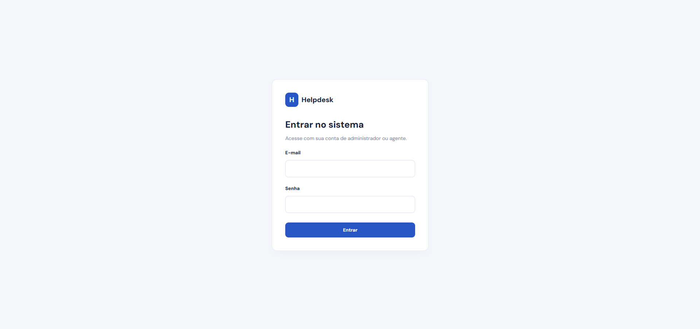
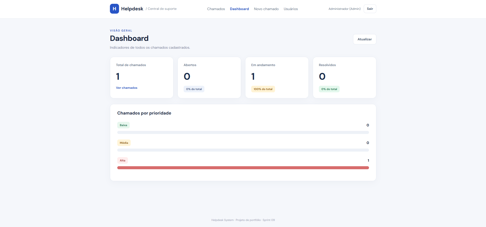
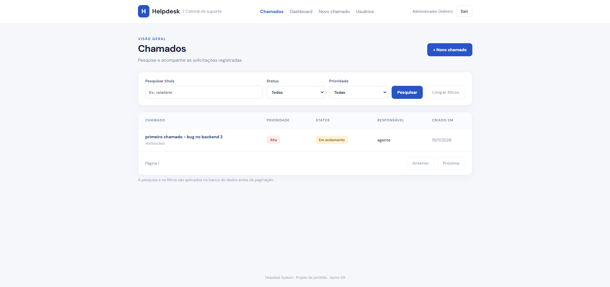
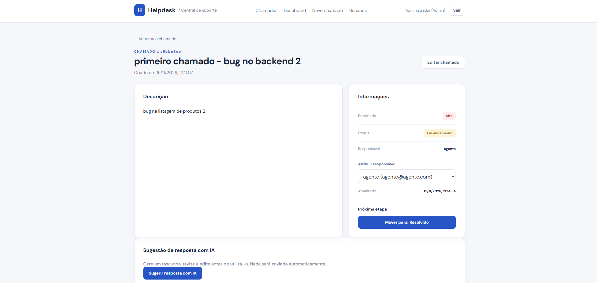

# Helpdesk System — Sistema de Gestão de Chamados

Sistema de gestão de chamados desenvolvido como projeto de portfólio full-stack, com autenticação, controle de permissões, dashboard, histórico de atividades e funcionalidades de inteligência artificial.

A aplicação está publicada na nuvem, com frontend e backend hospedados no Render e banco de dados PostgreSQL no Neon.

### Acesse o projeto

- **Aplicação:** https://helpdesk-web-koa7.onrender.com
- **API:** https://helpdesk-api-qg0c.onrender.com
- **Documentação interativa da API:** https://helpdesk-api-qg0c.onrender.com/docs

> O projeto utiliza serviços gratuitos de hospedagem. O primeiro acesso pode demorar alguns instantes devido à inicialização dos serviços.

## Demonstração visual

### Tela de login



### Dashboard

Visão geral dos chamados e indicadores por status e prioridade.



### Gestão de chamados

Listagem de chamados com pesquisa, filtros e paginação.



### Detalhes do chamado

Visualização das informações, comentários, histórico de atividades e funcionalidades de IA.



## Tecnologias

**Backend**
- Python e FastAPI
- SQLAlchemy
- PostgreSQL
- Alembic
- Autenticação JWT
- Argon2 para hash de senhas
- Pytest

**Frontend**
- React
- TypeScript
- Vite
- React Router
- Vitest e React Testing Library

**Infraestrutura**
- Docker e Docker Compose
- GitHub Actions
- Render (frontend e backend)
- Neon (PostgreSQL)

**Inteligência artificial**
- Integração com provedores de IA
- Modo mock para demonstração pública

## Funcionalidades

### Autenticação e usuários
- Login com autenticação JWT.
- Perfis de acesso `admin` e `agent`.
- Criação e listagem de usuários por administradores.
- Proteção das rotas conforme permissões.
- Ausência de cadastro público de usuários.

### Gestão de chamados
- Criação, listagem, consulta e edição de chamados.
- Alteração de status e prioridade.
- Pesquisa, filtros e paginação.
- Atribuição de responsáveis.
- Dashboard com indicadores por status e prioridade.

### Comentários e histórico
- Registro de comentários nos chamados.
- Histórico de alterações de status e atribuição.
- Paginação das atividades.

### Inteligência artificial
- Triagem assistida de chamados.
- Sugestões de respostas.
- Resumos de atividades.
- Suporte a modo mock para demonstrações sem consumo de APIs externas.

### Segurança e qualidade
- Senhas protegidas com Argon2.
- Controle de acesso baseado em perfis.
- Limitação de requisições para login e funcionalidades de IA.
- Sanitização de dados sensíveis antes do envio a provedores externos de IA.
- Testes automatizados de backend e frontend.
- Integração contínua com GitHub Actions.

## Arquitetura

```text
React + TypeScript
        |
        | HTTPS / API REST
        v
     FastAPI
        |
        | SQLAlchemy
        v
  PostgreSQL (Neon)
```

O frontend é publicado como Static Site no Render, enquanto a API FastAPI é executada em um Web Service.

O banco PostgreSQL é hospedado no Neon, com versionamento do esquema por meio do Alembic.

## Como executar localmente

### Pré-requisitos

- Python
- Node.js e npm
- PostgreSQL
- Git

### 1. Clonar o repositório

```bash
git clone https://github.com/CaioMiranda12/helpdesk-system
cd helpdesk-system
```

### 2. Configurar o backend

No terminal:

```powershell
cd backend

python -m venv .venv

.\.venv\Scripts\Activate.ps1

python -m pip install -r requirements.txt
```

Copie `backend/.env.example` para `backend/.env` e configure as variáveis necessárias, incluindo:

- `DATABASE_URL`
- `JWT_SECRET_KEY`
- Configurações de ambiente e IA, conforme o arquivo de exemplo.

Para gerar uma chave JWT:

```powershell
python -c "import secrets; print(secrets.token_urlsafe(48))"
```

Nunca envie o arquivo `.env` para o GitHub.

Com o PostgreSQL local configurado, execute:

```powershell
alembic upgrade head
python -m scripts.create_admin
python -m pytest -q
python -m uvicorn app.main:app --reload
```

API local: http://127.0.0.1:8000

Swagger: http://127.0.0.1:8000/docs

### 3. Configurar o frontend

Em outro terminal:

```powershell
cd frontend

npm install
npm run typecheck
npm test
npm run build
npm run dev
```

Acesse:

http://localhost:5173/login

Configure a URL da API no frontend conforme as variáveis de ambiente utilizadas pelo projeto.

## Deploy

A aplicação está publicada utilizando:

| Componente | Plataforma |
|---|---|
| Frontend React | Render Static Site |
| Backend FastAPI | Render Web Service |
| Banco PostgreSQL | Neon |

O frontend possui uma regra de Rewrite (`/*` → `/index.html`) para permitir o acesso direto e a atualização de páginas gerenciadas pelo React Router.

O ambiente de demonstração utiliza o provedor de IA em modo mock.

## Testes

**Backend**

```powershell
cd backend
python -m pytest -q
```

**Frontend**

```powershell
cd frontend
npm run typecheck
npm test
npm run build
```

O projeto também utiliza GitHub Actions para automatizar verificações.

## Documentação

- [Contrato da API](docs/api.md)
- [Arquitetura](docs/architecture.md)
- [Histórico de decisões](docs/decisions.md)
- [Roteiro de portfólio](docs/portfolio.md)
- [Checklist de segurança](docs/security-checklist.md)
- [Sprint 08 — Autenticação](docs/sprint-08.md)
- [Sprint 09 — Gestão de usuários](docs/sprint-09.md)
- [Sprint 10 — Atribuição de responsáveis](docs/sprint-10.md)
- [Sprint 11 — Comentários e histórico](docs/sprint-11.md)
- [Sprint 12 — Histórico paginado](docs/sprint-12.md)
- [Sprint 13 — Testes de frontend](docs/sprint-13.md)
- [Sprint 14 — Preparação para deploy](docs/sprint-14.md)

